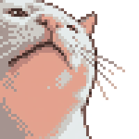
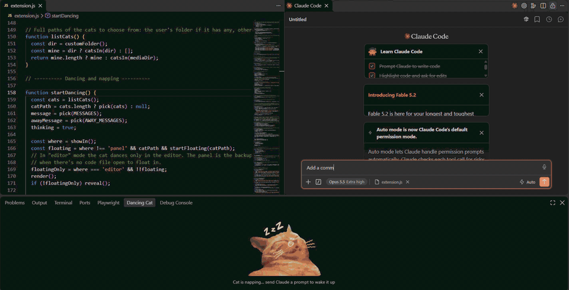

<p align="center"></p>

# Dancing Cat for Claude Code 🐱💃

A random cat dances in VS Code while Claude Code is thinking, and takes a nap when Claude is done.

<!-- TODO: add a short demo GIF here, saved as images/demo.gif, e.g.  -->


> Not affiliated with or endorsed by Anthropic. "Claude" and "Claude Code" are trademarks of Anthropic.

## Features

- 🕺 **Dances while Claude works.** Every prompt picks a random cat.
- 😴 **Naps when Claude is done.** A sleeping cat waits for your next prompt.
- 📍 **Your choice of spot.** A **Dancing Cat** panel tab, a cat **floating next to your cursor** (experimental), or both.
- 🖼️ **Bring your own cats.** Point it at a folder of your favourite GIFs.
- ✋ **One click to stop.** Click the dancing cat in the status bar.

## Requirements

- VS Code 1.80 or newer
- Claude Code, either the VS Code extension or the terminal version
- [Node.js](https://nodejs.org) installed and on your `PATH` (the hooks use it to tell the cat what Claude is doing)

## Getting started

1. Install **Dancing Cat for Claude Code** from the [VS Code Marketplace](https://marketplace.visualstudio.com/items?itemName=fatemeh-mokhtari.claude-dancing-cat) (or search for "Dancing Cat" in the Extensions view). You can also download the `.vsix` file from the [GitHub Releases](https://github.com/Fateme-mokhtari/claude-dancing-cat/releases) page and install it with **Extensions: Install from VSIX...**.
2. Click **Set Up** in the message that appears. (Or open the Command Palette with `Ctrl+Shift+P` / `Cmd+Shift+P` and run **Dancing Cat: Install Claude Code Hooks**.)
3. Restart Claude Code and send it a prompt. The cat starts dancing!

Run **Dancing Cat: Test Dance** any time to see a cat for 5 seconds.

## Where the cat appears

Run **Dancing Cat: Choose Where the Cat Appears**:

| Option | What you get |
|---|---|
| **Panel** (default) | The **Dancing Cat** tab in the bottom panel. Drag the tab anywhere you like: next to the Terminal, into a sidebar, or under the Claude chat. |
| **Floating in the editor** *(experimental)* | A small cat next to your cursor, on top of your code. Clicks go through it. Meanwhile the panel shows a trail of paw prints 🐾. If no code file is open, the cat dances in the panel instead. |
| **Both** | Panel and floating. |

## Use your own cats

Run **Dancing Cat: Choose Cats Folder** and pick a folder with `.gif`, animated `.webp`, `.png` or `.jpg` files. A random one dances each time Claude starts thinking. Choose **Use the built-in cats** to switch back.

Tip: cats with a transparent background look best, especially when floating. On giphy.com, the **Stickers** tab has these.

## Commands

| Command | What it does |
|---|---|
| Dancing Cat: Test Dance | Shows a dancing cat for 5 seconds |
| Dancing Cat: Stop Dancing | Puts the cat back to sleep (same as clicking the status bar cat) |
| Dancing Cat: Choose Where the Cat Appears | Panel, floating, or both |
| Dancing Cat: Choose Cats Folder | Use your own cats, or the built-in ones |
| Dancing Cat: Install Claude Code Hooks | Sets up the connection to Claude Code |
| Dancing Cat: Remove Claude Code Hooks | Removes that connection again |

## Settings

| Setting | Default | Description |
|---|---|---|
| `dancingCat.showIn` | `panel` | `panel`, `editor` (floating, experimental) or `both` |
| `dancingCat.catsFolder` | *(empty)* | Folder with your own cats. Empty means the built-in cats. Relative paths (like `cats` or `~/cats`) are counted from your home folder. |

## What it changes on your computer

- **Claude Code settings:** it adds 3 small [hooks](https://code.claude.com/docs/en/hooks) to `~/.claude/settings.json`. These are commands Claude Code runs when you send a prompt, when it finishes, and when it closes. Before every change, your previous file is saved as `settings.json.bak`. The very first time, an extra copy is saved as `settings.json.before-dancing-cat`, which is never overwritten and stays even after you uninstall. If the file can't be read (for example, it contains comments), **nothing is changed** and you'll see an error instead.
- **One small file:** the hooks write `thinking` or `idle` to `~/.claude/dancing-cat.state`, and the extension watches that file.
- **No internet, no tracking:** the extension makes no network requests and collects no data.

<details>
<summary>Prefer to add the hooks by hand?</summary>

Add this to `~/.claude/settings.json` (merge it with any hooks you already have):

```json
{
  "hooks": {
    "UserPromptSubmit": [{ "hooks": [{ "type": "command",
      "command": "node -e \"require('fs').writeFileSync(require('path').join(require('os').homedir(),'.claude','dancing-cat.state'),'thinking')\"" }] }],
    "Stop": [{ "hooks": [{ "type": "command",
      "command": "node -e \"require('fs').writeFileSync(require('path').join(require('os').homedir(),'.claude','dancing-cat.state'),'idle')\"" }] }],
    "SessionEnd": [{ "hooks": [{ "type": "command",
      "command": "node -e \"require('fs').writeFileSync(require('path').join(require('os').homedir(),'.claude','dancing-cat.state'),'idle')\"" }] }]
  }
}
```
</details>

## Removing it

Run **Dancing Cat: Remove Claude Code Hooks**. If you just uninstall the extension, the hooks and the state file are removed automatically the next time VS Code restarts.

## Known limitations

- **Pressing Esc in Claude:** Claude Code doesn't run its "Stop" hook when you interrupt it, so the cat keeps dancing. Click the cat in the status bar (or run **Dancing Cat: Stop Dancing**).
- **One cat for all sessions:** every Claude Code session on your computer controls the cat in every VS Code window. With two sessions running, the cat naps as soon as one of them finishes.
- **Shared hooks:** if you use this extension in more than one editor (for example VS Code and Cursor), they share the same hooks. Uninstalling it from one editor removes the hooks for all of them; run **Install Claude Code Hooks** again in the other editor.
- **The floating cat is experimental.** VS Code has no official way to show pictures on top of code, so it uses a CSS workaround that a future VS Code update could break.
- Mostly tested on Windows. macOS and Linux should work, but have had less testing.

## Contributing

Found a bug or have an idea? Open an [issue](https://github.com/Fateme-mokhtari/claude-dancing-cat/issues). Want to build or change the extension yourself? See [DEVELOPMENT.md](DEVELOPMENT.md).

## License

[MIT](LICENSE) © Fatemeh Mokhtari
